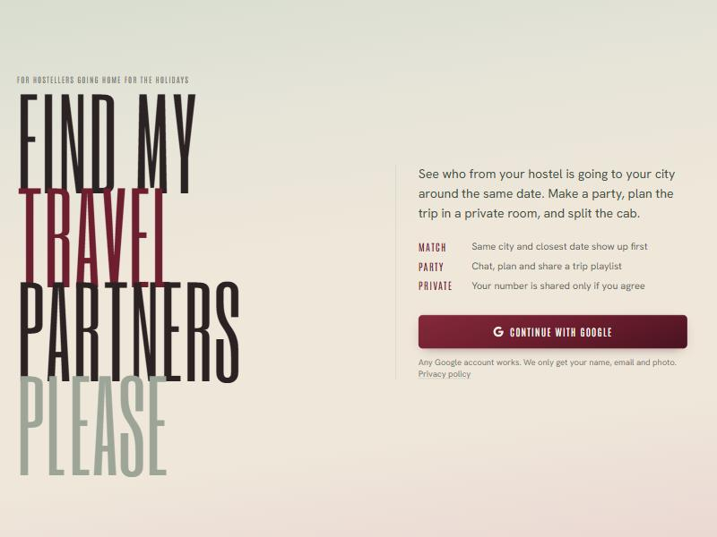
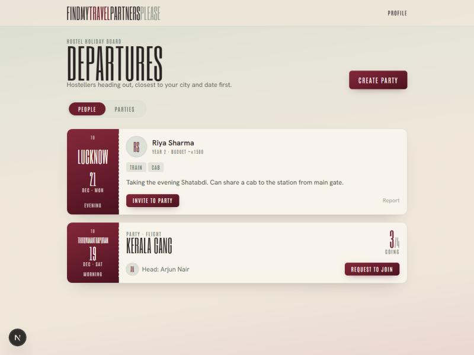

# FindMyTravelPartnersPlease

**Find hostel mates going to your city on the same dates, form a travel party, and plan the trip in a private room.**

A small web app for our institute's hostel students. Before every holiday, hundreds of hostellers leave for the same handful of cities around the same days, and most of them find travel company by spamming WhatsApp groups. This app replaces that with one board: say where and when you're going, see who else is, and team up.

<p align="center">
  
  
</p>

> Status: **pre-launch.** The app is built and the production build passes. Database setup and end-to-end testing are in progress. See [TODO_FINAL.md](TODO_FINAL.md).

---

## Features

**Matching**
- Profile with College User ID, photo, year (can be hidden), phone/WhatsApp, gender and budget
- Trip details: destination city, travel date, preferred time, travel mediums, gender preference and a short bio
- A **Departures** board sorted by same city first, then closest date
- Filters for city, date range, travel medium and year, plus name search
- **Mutual gender preference**: you see someone only if both preferences allow it
- Budget is shown on profiles but never used to filter anyone out

**Parties**
- Create a party for a trip; the creator becomes the party head
- The head invites people, or people request to join; the other side accepts
- 🔔 Live notification bell for pending invites and requests

**Party room**
- Live text chat
- WhatsApp numbers are shared only if you agree, and only with members who also agreed
- **Vibe**: a shared song list for the trip
- The room closes automatically 2 days after the travel date, and the head can delete it anytime
- Each member is asked "helpful or nah?" after the room ends

**Safety**
- Report users you've actually travelled or chatted with; 3 reports from different people suspend the account until an admin reviews it
- Other people's private details (phone, email, College ID) can't be read through the API. Only public card fields are exposed.

---

## Tech stack

| Layer | Choice |
|---|---|
| Frontend | [Next.js 16](https://nextjs.org) (App Router, TypeScript), Tailwind CSS v4 |
| Backend | [Supabase](https://supabase.com): Postgres, Row Level Security, SQL functions |
| Auth | Google sign-in through Supabase Auth |
| Realtime | Supabase Realtime (chat + notification bell) |
| Storage | Supabase Storage (profile photos, resized to 256px in the browser) |
| Jobs | pg_cron (daily cleanup of ended rooms) |
| Hosting | Vercel |

Design: muted sage grey, warm cream beige and deep burgundy. Type is set in Six Caps (display), Antonio (labels) and Hanken Grotesk (body). Cards are styled as boarding passes.

---

## How the data stays private

All cross-user reads go through `security definer` SQL functions that return only public columns. There is no table policy that lets you `select` another person's row.

| Data | Who can see it |
|---|---|
| Name, photo, year (if shown), budget, bio, trip | Any signed-in user whose gender preference matches yours both ways |
| Phone / WhatsApp | Only party members who **both** chose to share |
| Email, College ID, gender | Only you |
| Chat and songs | Only members of that party, while it's active |

Details: [`supabase/migrations/0001_init.sql`](supabase/migrations/0001_init.sql) and the public [privacy page](app/privacy/page.tsx).

---

## Project structure

```
app/
  login/  auth/callback/          Google sign-in
  onboarding/details/  trip/      Two-step onboarding
  panel/                          Departures board (People / Parties)
  party/new/  party/[id]/         Create party, party room (chat, vibe, people)
  profile/                        Edit profile, invites and requests, my parties
  privacy/  suspended/            Public privacy policy, suspended screen
components/                       Header, Inbox, forms, TicketStub, Avatar, ...
lib/                              Supabase clients, constants (city list), types
proxy.ts                          Auth + onboarding gate (Next 16 "proxy", formerly middleware)
supabase/migrations/              Database schema, RLS, functions, storage, cron
```

---

## Getting started (local)

**Requirements:** Node.js 20+ and a free Supabase project.

```bash
git clone https://github.com/Aryan-Is-Here/FindMyTravelPartnersPlease.git
cd FindMyTravelPartnersPlease
npm install
cp .env.example .env.local   # then fill in your Supabase URL + publishable key
npm run dev
```

Then follow **[SETUP.md](SETUP.md)** for the one-time steps:
1. Run the SQL migration in the Supabase SQL Editor
2. Create a Google OAuth client and enable Google in Supabase
3. Add `http://localhost:3000/auth/callback` to the Supabase redirect URLs

Open http://localhost:3000.

| Command | What it does |
|---|---|
| `npm run dev` | Start the dev server |
| `npm run build` | Production build |
| `npm run lint` | ESLint |

---

## Deploying

Step-by-step guide: **[PUBLISH.md](PUBLISH.md)** (Vercel, live URLs in Supabase + Google, publishing the Google consent screen, after-launch admin tasks).

The free tiers of Supabase and Vercel are enough for 400+ users. The numbers are in [SETUP.md](SETUP.md#free-tier-limits-checked-2026-10-28).

---

## Docs

| File | What's in it |
|---|---|
| [SETUP.md](SETUP.md) | One-time setup: database, Google sign-in, URLs, free-tier limits |
| [PUBLISH.md](PUBLISH.md) | Going live and running the site after launch |
| [TODO_FINAL.md](TODO_FINAL.md) | Everything still left before the project is final |
| [PROJECT_CONTEXT.md](PROJECT_CONTEXT.md) | Why things are the way they are: decisions, progress, change log |

---

## Contributing

Issues and suggestions are welcome. Open an issue on this repo. For a data deletion request, open an issue or message the maintainer.

Built by [Aryan](https://github.com/Aryan-Is-Here) for the hostellers of our institute.
